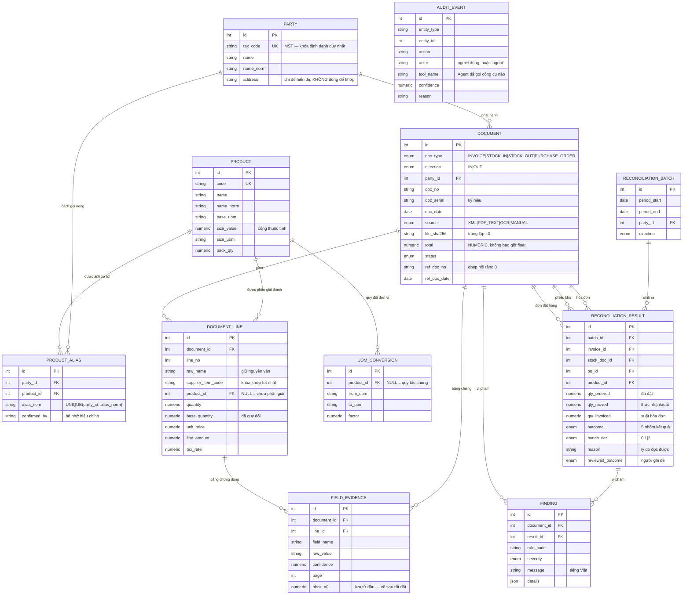

# ERD — Reconia

11 bảng. Nguồn sự thật là `app/models/`; sơ đồ này để đọc và để đưa vào báo cáo.

## Ba quyết định thiết kế đáng chú ý

**Một bảng `document` cho cả bốn loại.** `doc_type` nói nó là gì, `direction` nói hàng đi
chiều nào. Nhờ vậy engine đối soát chạy **không đổi một dòng** cho cả chiều nhập lẫn chiều
xuất — đó chính là điều làm *"chứng từ nhập xuất"* thành một engine chứ không phải hai.

**`RECONCILIATION_RESULT` giữ cả ba số lượng.** Đặt, thực nhận, xuất hóa đơn nằm trên cùng
một dòng nên chênh lệch ba chiều nhìn thấy ngay, không cần join lại.

**`FIELD_EVIDENCE` có tọa độ ngay từ đầu.** Màn hình đối chiếu song song tốn 1 ngày nếu đã
có tọa độ, tốn hơn một tuần nếu phải làm lại từ đầu.
