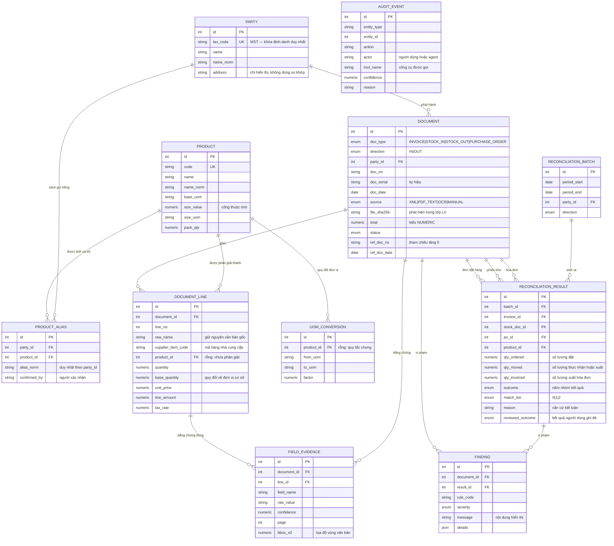

# LƯỢC ĐỒ QUAN HỆ DỮ LIỆU

**Đề tài:** Đánh giá và so sánh các phương pháp học sâu cho bài toán trích xuất thông tin
từ hóa đơn (ĐA161)

> [!NOTE]
> **Trạng thái: Lớp ứng dụng mở rộng (Frozen Demo Layer).**
> Lược đồ cơ sở dữ liệu dưới đây phục vụ cho lớp ứng dụng đối soát 3 chiều và lưu vết thực thể (ERP 3-way matching demo layer) trong `app/models/`. Lớp ứng dụng này đã được đóng băng để tập trung vào mục tiêu nghiên cứu học thuật của đề tài: so sánh và đánh giá 4 mô hình Deep Learning trên 3 bộ dữ liệu hóa đơn.

Lược đồ gồm mười một bảng. Định nghĩa chính thức nằm trong `app/models/`; sơ đồ dưới đây
biểu diễn lại cấu trúc đó phục vụ việc đọc hiểu và tham khảo:

## Các quyết định thiết kế chính

**Sử dụng một bảng `DOCUMENT` cho cả bốn loại chứng từ.** Trường `doc_type` xác định loại chứng
từ, trường `direction` xác định chiều luân chuyển hàng hóa. Nhờ đó thành phần đối soát vận hành
không thay đổi đối với cả chiều nhập và chiều xuất, thay vì phải xây dựng hai thành phần riêng biệt.

**Bảng `RECONCILIATION_RESULT` lưu đồng thời ba đại lượng số lượng.** Số lượng đặt, số lượng thực
nhận hoặc xuất, và số lượng xuất hóa đơn cùng nằm trên một bản ghi, cho phép xác định chênh lệch
ba chiều mà không cần thực hiện phép kết nối bổ sung.

**Bảng `FIELD_EVIDENCE` lưu tọa độ vùng văn bản ngay từ lần trích xuất đầu tiên.** Việc bổ sung
tọa độ sau khi dữ liệu đã được trích xuất đòi hỏi xử lý lại toàn bộ tập chứng từ.
