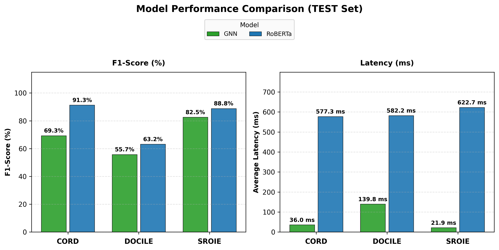

# Bảng So Sánh Tổng Hợp Các Mô Hình

Tổng hợp kết quả thực nghiệm từ các file trong thư mục `reports/` (ưu tiên đánh giá trên tập **TEST** độc lập):

## 1. Kết Quả Tổng Hợp

| Mô hình | Bộ dữ liệu | Tập | Epoch | Precision (%) | Recall (%) | F1 (%) | Latency (ms) |
|---|---|:---:|:---:|---|---|---|---|
| **GNN** | `CORD` | `TEST` | 15 | 64.09% | 75.36% | **69.27%** | 35.98 ms |
| **RoBERTa** | `CORD` | `TEST` | 12 | 91.03% | 91.51% | **91.27%** | 577.28 ms |
| **GNN** | `DOCILE` | `TEST` | 18 | 52.75% | 59.08% | **55.74%** | 139.84 ms |
| **RoBERTa** | `DOCILE` | `TEST` | 19 | 75.29% | 54.40% | **63.17%** | 582.18 ms |
| **GNN** | `SROIE` | `TEST` | 12 | 80.54% | 84.66% | **82.55%** | 21.89 ms |
| **RoBERTa** | `SROIE` | `TEST` | 15 | 86.33% | 91.48% | **88.83%** | 622.72 ms |

## 2. Biểu Đồ So Sánh

