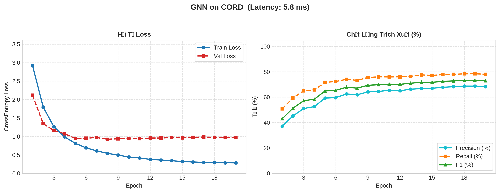

# Báo Cáo Thực Nghiệm: GNN trên Bộ Dữ Liệu CORD

Giao thức: `ocr-bio-exact-span-v2`. Đây là chỉ số nội bộ, không phải điểm DocILE chính thức.

## 1. Kết Quả Thực Nghiệm Tối Ưu

| Chỉ số | Tập Validation | Tập Test |
|---|:---:|:---:|
| **Precision** | 68.67% | **64.50%** |
| **Recall** | 78.40% | **75.89%** |
| **F1-Score** | 73.21% | **69.73%** |
| **Latency** | 5.65 ms | 59.90 ms |

- **Mô hình**: `GNN` | **Thiết bị**: `cuda` | **Tham số**: 3,942,589 | **Epoch tối ưu**: 19
- **Train Loss**: 0.2846 | **Val Loss**: 0.9735

## 2. Kết Quả Theo Từng Nhãn Thực Thể

| Nhãn | Precision | Recall | F1 | Mẫu (Support) |
|---|---|---|---|---|
| `menu.cnt` | 93.58% | 92.73% | **93.15%** | 220 |
| `menu.discountprice` | 75.00% | 60.00% | **66.67%** | 10 |
| `menu.etc` | 0.00% | 0.00% | **0.00%** | 3 |
| `menu.itemsubtotal` | 0.00% | 0.00% | **0.00%** | 6 |
| `menu.nm` | 75.09% | 83.73% | **79.17%** | 252 |
| `menu.num` | 83.33% | 90.91% | **86.96%** | 11 |
| `menu.price` | 83.33% | 85.37% | **84.34%** | 246 |
| `menu.sub.cnt` | 52.00% | 76.47% | **61.90%** | 17 |
| `menu.sub.nm` | 50.00% | 69.44% | **58.14%** | 36 |
| `menu.sub.price` | 69.23% | 90.00% | **78.26%** | 20 |
| `menu.sub.unitprice` | 0.00% | 0.00% | **0.00%** | 0 |
| `menu.unitprice` | 91.23% | 77.61% | **83.87%** | 67 |
| `sub_total.discount_price` | 20.00% | 42.86% | **27.27%** | 7 |
| `sub_total.etc` | 18.18% | 30.77% | **22.86%** | 13 |
| `sub_total.service_price` | 35.00% | 53.85% | **42.42%** | 13 |
| `sub_total.subtotal_price` | 39.13% | 52.94% | **45.00%** | 68 |
| `sub_total.tax_price` | 39.47% | 65.22% | **49.18%** | 46 |
| `total.cashprice` | 50.56% | 62.50% | **55.90%** | 72 |
| `total.changeprice` | 52.56% | 71.93% | **60.74%** | 57 |
| `total.creditcardprice` | 10.00% | 17.65% | **12.77%** | 17 |
| `total.emoneyprice` | 0.00% | 0.00% | **0.00%** | 2 |
| `total.menuqty_cnt` | 45.65% | 72.41% | **56.00%** | 29 |
| `total.menutype_cnt` | 25.00% | 28.57% | **26.67%** | 7 |
| `total.total_etc` | 0.00% | 0.00% | **0.00%** | 3 |
| `total.total_price` | 45.80% | 61.86% | **52.63%** | 97 |
| **Tổng thể** | **64.50%** | **75.89%** | **69.73%** | — |

## 3. Biểu Đồ Huấn Luyện

## 4. Lịch Sử Huấn Luyện

| Epoch | Train Loss | Val Loss | Precision | Recall | F1 | Latency (ms) |
|---|---|---|---|---|---|---|
| 1 | 2.9282 | 2.1187 | 37.18% | 50.81% | **42.94%** | 7.3 |
| 2 | 1.7959 | 1.3445 | 45.14% | 59.30% | **51.26%** | 6.0 |
| 3 | 1.2626 | 1.1605 | 50.98% | 64.97% | **57.13%** | 5.8 |
| 4 | 0.9858 | 1.0713 | 52.52% | 65.70% | **58.38%** | 5.6 |
| 5 | 0.8135 | 0.9451 | 59.24% | 71.60% | **64.84%** | 5.4 |
| 6 | 0.6897 | 0.9512 | 59.60% | 72.33% | **65.35%** | 5.6 |
| 7 | 0.6088 | 0.9677 | 62.50% | 74.03% | **67.78%** | 7.3 |
| 8 | 0.5405 | 0.9241 | 61.86% | 73.22% | **67.06%** | 5.8 |
| 9 | 0.4938 | 0.9352 | 64.12% | 75.49% | **69.34%** | 5.6 |
| 10 | 0.4401 | 0.9450 | 64.49% | 75.97% | **69.76%** | 5.4 |
| 11 | 0.4170 | 0.9378 | 65.37% | 75.89% | **70.24%** | 5.5 |
| 12 | 0.3761 | 0.9563 | 65.03% | 75.97% | **70.07%** | 5.6 |
| 13 | 0.3593 | 0.9550 | 66.25% | 76.38% | **70.95%** | 5.5 |
| 14 | 0.3419 | 0.9678 | 66.71% | 77.51% | **71.71%** | 5.5 |
| 15 | 0.3170 | 0.9601 | 66.97% | 77.10% | **71.68%** | 5.9 |
| 16 | 0.3067 | 0.9770 | 67.72% | 77.75% | **72.39%** | 5.8 |
| 17 | 0.2957 | 0.9822 | 68.22% | 77.99% | **72.78%** | 5.7 |
| 18 | 0.2894 | 0.9760 | 68.70% | 78.32% | **73.19%** | 5.7 |
| 19 | 0.2846 | 0.9735 | 68.67% | 78.40% | **73.21%** | 5.7 |
| 20 | 0.2823 | 0.9728 | 68.27% | 77.99% | **72.81%** | 5.4 |
