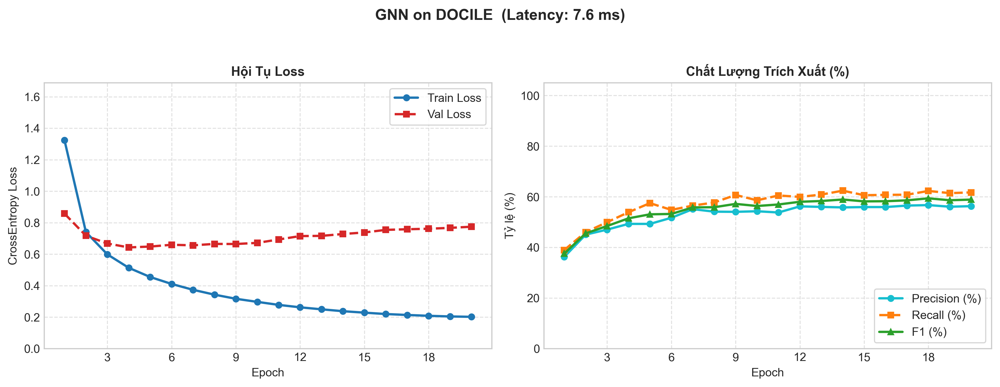

# Báo Cáo Thực Nghiệm: GNN trên Bộ Dữ Liệu DOCILE

## 1. Kết Quả Thực Nghiệm Tối Ưu

| Chỉ số | Tập Validation | Tập Test |
|---|:---:|:---:|
| **Precision** | 56.70% | **52.75%** |
| **Recall** | 62.30% | **59.08%** |
| **F1-Score** | 59.37% | **55.74%** |
| **Latency** | 7.39 ms | 139.84 ms |

- **Mô hình**: `GNN` | **Thiết bị**: `cuda` | **Tham số**: 3,949,297 | **Epoch tối ưu**: 18
- **Train Loss**: 0.2083 | **Val Loss**: 0.7617

## 2. Kết Quả Theo Từng Nhãn Thực Thể

| Nhãn | Precision | Recall | F1 | Mẫu (Support) |
|---|---|---|---|---|
| `account_num` | 71.43% | 55.56% | **62.50%** | 9 |
| `amount_due` | 47.97% | 49.86% | **48.90%** | 355 |
| `amount_paid` | 40.00% | 43.48% | **41.67%** | 23 |
| `amount_total_gross` | 33.65% | 20.65% | **25.59%** | 339 |
| `amount_total_net` | 26.53% | 23.64% | **25.00%** | 55 |
| `amount_total_tax` | 13.04% | 12.00% | **12.50%** | 25 |
| `bank_num` | 71.43% | 83.33% | **76.92%** | 6 |
| `currency_code_amount_due` | 25.00% | 44.00% | **31.88%** | 25 |
| `customer_billing_address` | 47.61% | 69.33% | **56.45%** | 489 |
| `customer_billing_name` | 45.44% | 60.99% | **52.08%** | 523 |
| `customer_delivery_address` | 25.00% | 37.50% | **30.00%** | 32 |
| `customer_delivery_name` | 40.62% | 48.15% | **44.07%** | 27 |
| `customer_id` | 66.01% | 60.48% | **63.12%** | 167 |
| `customer_order_id` | 44.68% | 47.73% | **46.15%** | 44 |
| `customer_other_address` | 23.08% | 41.38% | **29.63%** | 29 |
| `customer_other_name` | 30.67% | 34.33% | **32.39%** | 134 |
| `customer_registration_id` | 0.00% | 0.00% | **0.00%** | 2 |
| `customer_tax_id` | 0.00% | 0.00% | **0.00%** | 0 |
| `date_due` | 66.67% | 65.88% | **66.27%** | 85 |
| `date_issue` | 71.69% | 71.26% | **71.47%** | 501 |
| `document_id` | 72.67% | 77.19% | **74.86%** | 434 |
| `line_item_amount_gross` | 55.59% | 65.84% | **60.28%** | 1,534 |
| `line_item_amount_net` | 28.57% | 7.89% | **12.36%** | 279 |
| `line_item_code` | 42.51% | 43.12% | **42.81%** | 480 |
| `line_item_currency` | 40.36% | 63.21% | **49.26%** | 106 |
| `line_item_date` | 74.46% | 86.38% | **79.98%** | 1,961 |
| `line_item_description` | 37.86% | 45.95% | **41.51%** | 1,887 |
| `line_item_discount_amount` | 0.00% | 0.00% | **0.00%** | 6 |
| `line_item_discount_rate` | 0.00% | 0.00% | **0.00%** | 3 |
| `line_item_hts_number` | 100.00% | 100.00% | **100.00%** | 3 |
| `line_item_order_id` | 10.00% | 16.67% | **12.50%** | 12 |
| `line_item_person_name` | 52.63% | 47.62% | **50.00%** | 21 |
| `line_item_position` | 86.07% | 68.99% | **76.59%** | 761 |
| `line_item_quantity` | 78.29% | 77.01% | **77.64%** | 1,344 |
| `line_item_tax` | 50.00% | 13.33% | **21.05%** | 30 |
| `line_item_unit_price_gross` | 70.27% | 78.79% | **74.29%** | 1,353 |
| `line_item_unit_price_net` | 28.95% | 15.60% | **20.28%** | 141 |
| `line_item_units_of_measure` | 64.00% | 14.55% | **23.70%** | 220 |
| `line_item_weight` | 22.22% | 12.50% | **16.00%** | 16 |
| `order_id` | 55.30% | 49.32% | **52.14%** | 296 |
| `payment_reference` | 56.52% | 61.90% | **59.09%** | 21 |
| `payment_terms` | 58.46% | 69.09% | **63.33%** | 165 |
| `tax_detail_gross` | 22.22% | 37.50% | **27.91%** | 16 |
| `tax_detail_net` | 15.62% | 31.25% | **20.83%** | 16 |
| `tax_detail_rate` | 100.00% | 37.50% | **54.55%** | 8 |
| `tax_detail_tax` | 24.00% | 41.38% | **30.38%** | 29 |
| `vendor_address` | 38.23% | 61.89% | **47.26%** | 593 |
| `vendor_email` | 54.55% | 66.67% | **60.00%** | 45 |
| `vendor_name` | 45.85% | 53.64% | **49.44%** | 660 |
| `vendor_order_id` | 28.00% | 46.67% | **35.00%** | 15 |
| `vendor_registration_id` | 25.00% | 100.00% | **40.00%** | 1 |
| `vendor_tax_id` | 77.61% | 91.23% | **83.87%** | 57 |
| **Tổng thể** | **52.75%** | **59.08%** | **55.74%** | — |

## 3. Biểu Đồ Huấn Luyện

## 4. Lịch Sử Huấn Luyện

| Epoch | Train Loss | Val Loss | Precision | Recall | F1 | Latency (ms) |
|---|---|---|---|---|---|---|
| 1 | 1.3239 | 0.8577 | 36.23% | 38.95% | **37.54%** | 7.2 |
| 2 | 0.7404 | 0.7173 | 45.03% | 46.02% | **45.52%** | 7.0 |
| 3 | 0.5988 | 0.6679 | 47.02% | 49.94% | **48.43%** | 7.8 |
| 4 | 0.5133 | 0.6430 | 49.28% | 53.88% | **51.48%** | 7.8 |
| 5 | 0.4548 | 0.6484 | 49.27% | 57.48% | **53.06%** | 8.0 |
| 6 | 0.4109 | 0.6598 | 51.69% | 54.81% | **53.20%** | 7.6 |
| 7 | 0.3736 | 0.6562 | 55.10% | 56.50% | **55.79%** | 8.3 |
| 8 | 0.3428 | 0.6653 | 54.11% | 57.73% | **55.86%** | 8.7 |
| 9 | 0.3166 | 0.6646 | 54.03% | 60.70% | **57.17%** | 7.8 |
| 10 | 0.2969 | 0.6718 | 54.27% | 58.58% | **56.34%** | 7.7 |
| 11 | 0.2777 | 0.6935 | 53.78% | 60.50% | **56.94%** | 7.3 |
| 12 | 0.2623 | 0.7151 | 56.20% | 59.94% | **58.01%** | 7.4 |
| 13 | 0.2496 | 0.7164 | 55.99% | 60.85% | **58.32%** | 7.4 |
| 14 | 0.2376 | 0.7281 | 55.78% | 62.40% | **58.91%** | 7.5 |
| 15 | 0.2284 | 0.7381 | 55.93% | 60.61% | **58.17%** | 7.3 |
| 16 | 0.2196 | 0.7544 | 55.92% | 60.74% | **58.23%** | 7.3 |
| 17 | 0.2136 | 0.7584 | 56.51% | 60.81% | **58.58%** | 8.9 |
| 18 | 0.2083 | 0.7617 | 56.70% | 62.30% | **59.37%** | 7.4 |
| 19 | 0.2042 | 0.7672 | 56.06% | 61.43% | **58.62%** | 7.2 |
| 20 | 0.2019 | 0.7745 | 56.28% | 61.72% | **58.88%** | 7.1 |
