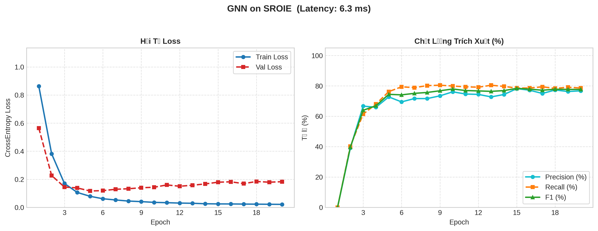

# Báo Cáo Thực Nghiệm: GNN trên Bộ Dữ Liệu SROIE

Giao thức: `ocr-bio-exact-span-v2`. Đây là chỉ số nội bộ, không phải điểm DocILE chính thức.

## 1. Kết Quả Thực Nghiệm Tối Ưu

| Chỉ số | Tập Validation | Tập Test |
|---|:---:|:---:|
| **Precision** | 78.16% | **78.19%** |
| **Recall** | 78.57% | **83.52%** |
| **F1-Score** | 78.36% | **80.77%** |
| **Latency** | 5.73 ms | 16.34 ms |

- **Mô hình**: `GNN` | **Thiết bị**: `cuda` | **Tham số**: 3,936,139 | **Epoch tối ưu**: 15
- **Train Loss**: 0.0249 | **Val Loss**: 0.1795

## 2. Kết Quả Theo Từng Nhãn Thực Thể

| Nhãn | Precision | Recall | F1 | Mẫu (Support) |
|---|---|---|---|---|
| `address` | 88.02% | 91.30% | **89.63%** | 161 |
| `company` | 79.45% | 82.86% | **81.12%** | 70 |
| `date` | 85.51% | 96.72% | **90.77%** | 61 |
| `total` | 44.78% | 50.00% | **47.24%** | 60 |
| **Tổng thể** | **78.19%** | **83.52%** | **80.77%** | — |

## 3. Biểu Đồ Huấn Luyện

## 4. Lịch Sử Huấn Luyện

| Epoch | Train Loss | Val Loss | Precision | Recall | F1 | Latency (ms) |
|---|---|---|---|---|---|---|
| 1 | 0.8630 | 0.5644 | 0.00% | 0.00% | **0.00%** | 14.5 |
| 2 | 0.3817 | 0.2272 | 39.07% | 40.21% | **39.63%** | 6.3 |
| 3 | 0.1706 | 0.1451 | 66.67% | 61.38% | **63.91%** | 6.1 |
| 4 | 0.1065 | 0.1386 | 65.90% | 67.99% | **66.93%** | 5.8 |
| 5 | 0.0792 | 0.1170 | 72.73% | 76.19% | **74.42%** | 5.7 |
| 6 | 0.0616 | 0.1194 | 69.44% | 79.37% | **74.07%** | 5.7 |
| 7 | 0.0530 | 0.1291 | 71.63% | 78.84% | **75.06%** | 6.5 |
| 8 | 0.0452 | 0.1329 | 71.63% | 80.16% | **75.66%** | 5.7 |
| 9 | 0.0412 | 0.1399 | 73.43% | 80.42% | **76.77%** | 6.0 |
| 10 | 0.0359 | 0.1434 | 76.07% | 79.89% | **77.94%** | 5.7 |
| 11 | 0.0336 | 0.1600 | 74.63% | 79.37% | **76.92%** | 6.2 |
| 12 | 0.0309 | 0.1506 | 74.38% | 79.10% | **76.67%** | 5.9 |
| 13 | 0.0294 | 0.1579 | 72.73% | 80.42% | **76.38%** | 5.8 |
| 14 | 0.0260 | 0.1672 | 74.32% | 79.63% | **76.88%** | 6.0 |
| 15 | 0.0249 | 0.1795 | 78.16% | 78.57% | **78.36%** | 5.7 |
| 16 | 0.0246 | 0.1822 | 77.14% | 78.57% | **77.85%** | 5.6 |
| 17 | 0.0237 | 0.1693 | 75.00% | 79.37% | **77.12%** | 5.8 |
| 18 | 0.0231 | 0.1845 | 77.28% | 78.31% | **77.79%** | 5.8 |
| 19 | 0.0223 | 0.1795 | 76.28% | 79.10% | **77.66%** | 5.6 |
| 20 | 0.0216 | 0.1832 | 76.74% | 78.57% | **77.65%** | 5.8 |

## Giá trị bốn trường gốc

GNN đạt F1 **54,70%** theo `sroie-four-field-nfkc-casefold-v1` trên 63 test, 251 giá trị có nhãn. Một key address thiếu nhãn gốc được loại khỏi phép chấm, không tự bổ sung. Ghép mọi đoạn dự đoán cùng loại theo thứ tự OCR; không chọn đoạn theo ground truth. Xem [metrics](predictions/gnn_sroie_test.four-field.metrics.json). Chỉ số này tách biệt với entity F1 và field-value trên đoạn OCR.
