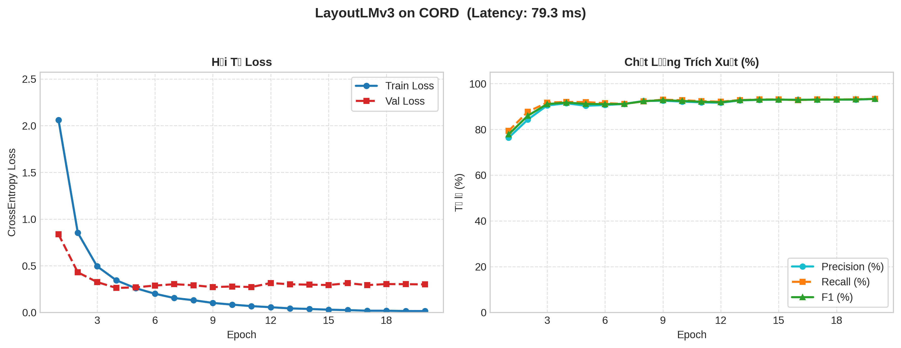

# Báo Cáo Thực Nghiệm: LayoutLMv3 trên Bộ Dữ Liệu CORD

Giao thức: `ocr-bio-exact-span-v2`. Đây là chỉ số nội bộ, không phải điểm DocILE chính thức.

## 1. Kết Quả Thực Nghiệm Tối Ưu

| Chỉ số | Tập Validation | Tập Test |
|---|:---:|:---:|
| **Precision** | 93.28% | **93.93%** |
| **Recall** | 93.28% | **93.93%** |
| **F1-Score** | 93.28% | **93.93%** |
| **Latency** | 79.34 ms | 188.74 ms |

- **Mô hình**: `LayoutLMv3` | **Thiết bị**: `cuda` | **Tham số**: 125,962,939 | **Epoch tối ưu**: 20
- **Train Loss**: 0.0150 | **Val Loss**: 0.3001

## 2. Kết Quả Theo Từng Nhãn Thực Thể

| Nhãn | Precision | Recall | F1 | Mẫu (Support) |
|---|---|---|---|---|
| `menu.cnt` | 98.64% | 99.09% | **98.87%** | 220 |
| `menu.discountprice` | 66.67% | 60.00% | **63.16%** | 10 |
| `menu.etc` | 0.00% | 0.00% | **0.00%** | 3 |
| `menu.itemsubtotal` | 0.00% | 0.00% | **0.00%** | 6 |
| `menu.nm` | 95.28% | 96.03% | **95.65%** | 252 |
| `menu.num` | 100.00% | 72.73% | **84.21%** | 11 |
| `menu.price` | 96.84% | 99.59% | **98.20%** | 246 |
| `menu.sub.cnt` | 89.47% | 100.00% | **94.44%** | 17 |
| `menu.sub.nm` | 92.11% | 97.22% | **94.59%** | 36 |
| `menu.sub.price` | 100.00% | 85.00% | **91.89%** | 20 |
| `menu.unitprice` | 92.65% | 94.03% | **93.33%** | 67 |
| `sub_total.discount_price` | 85.71% | 85.71% | **85.71%** | 7 |
| `sub_total.etc` | 91.67% | 84.62% | **88.00%** | 13 |
| `sub_total.service_price` | 76.92% | 76.92% | **76.92%** | 13 |
| `sub_total.subtotal_price` | 92.65% | 92.65% | **92.65%** | 68 |
| `sub_total.tax_price` | 85.42% | 89.13% | **87.23%** | 46 |
| `total.cashprice` | 95.45% | 87.50% | **91.30%** | 72 |
| `total.changeprice` | 86.44% | 89.47% | **87.93%** | 57 |
| `total.creditcardprice` | 88.24% | 88.24% | **88.24%** | 17 |
| `total.emoneyprice` | 33.33% | 50.00% | **40.00%** | 2 |
| `total.menuqty_cnt` | 90.62% | 100.00% | **95.08%** | 29 |
| `total.menutype_cnt` | 80.00% | 57.14% | **66.67%** | 7 |
| `total.total_etc` | 33.33% | 33.33% | **33.33%** | 3 |
| `total.total_price` | 93.94% | 95.88% | **94.90%** | 97 |
| **Tổng thể** | **93.93%** | **93.93%** | **93.93%** | — |

## 3. Biểu Đồ Huấn Luyện

## 4. Lịch Sử Huấn Luyện

| Epoch | Train Loss | Val Loss | Precision | Recall | F1 | Latency (ms) |
|---|---|---|---|---|---|---|
| 1 | 2.0612 | 0.8365 | 76.32% | 79.29% | **77.78%** | 79.4 |
| 2 | 0.8526 | 0.4295 | 84.29% | 87.70% | **85.96%** | 79.6 |
| 3 | 0.4940 | 0.3256 | 90.42% | 91.67% | **91.04%** | 79.6 |
| 4 | 0.3437 | 0.2622 | 91.40% | 91.99% | **91.69%** | 78.9 |
| 5 | 0.2599 | 0.2690 | 90.30% | 91.91% | **91.10%** | 79.8 |
| 6 | 0.2003 | 0.2879 | 90.62% | 91.42% | **91.02%** | 79.2 |
| 7 | 0.1544 | 0.3025 | 91.10% | 91.10% | **91.10%** | 79.6 |
| 8 | 0.1310 | 0.2916 | 92.38% | 92.23% | **92.31%** | 79.3 |
| 9 | 0.1021 | 0.2713 | 92.51% | 92.96% | **92.74%** | 79.1 |
| 10 | 0.0839 | 0.2782 | 92.12% | 92.72% | **92.42%** | 79.6 |
| 11 | 0.0678 | 0.2722 | 91.79% | 92.31% | **92.05%** | 79.4 |
| 12 | 0.0562 | 0.3152 | 91.63% | 92.07% | **91.85%** | 79.3 |
| 13 | 0.0435 | 0.3016 | 92.65% | 92.80% | **92.72%** | 79.5 |
| 14 | 0.0375 | 0.2976 | 92.89% | 93.04% | **92.97%** | 79.2 |
| 15 | 0.0297 | 0.2940 | 92.97% | 93.04% | **93.00%** | 79.1 |
| 16 | 0.0251 | 0.3135 | 92.95% | 92.80% | **92.87%** | 79.0 |
| 17 | 0.0188 | 0.2929 | 92.97% | 93.04% | **93.00%** | 79.0 |
| 18 | 0.0185 | 0.3040 | 92.97% | 93.04% | **93.00%** | 79.5 |
| 19 | 0.0153 | 0.3028 | 92.97% | 93.12% | **93.05%** | 79.4 |
| 20 | 0.0150 | 0.3001 | 93.28% | 93.28% | **93.28%** | 79.3 |
