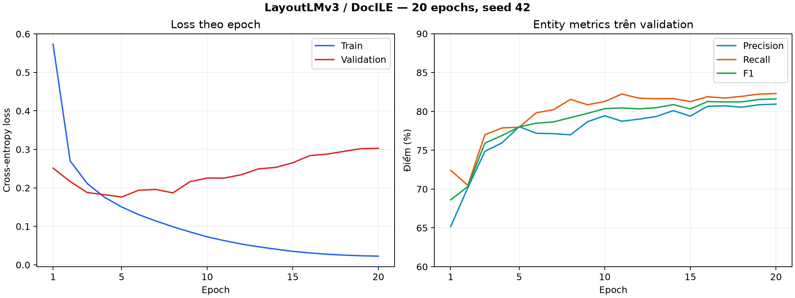

# Báo Cáo Thực Nghiệm: LayoutLMv3 trên Bộ Dữ Liệu DOCILE

Giao thức: `ocr-bio-exact-span-v2`. Đây là chỉ số nội bộ, không phải điểm DocILE chính thức.

## 1. Kết Quả Thực Nghiệm Tối Ưu

| Chỉ số | Tập Validation | Tập Test |
|---|:---:|:---:|
| **Precision** | 80.94% | **80.88%** |
| **Recall** | 82.30% | **85.63%** |
| **F1-Score** | 81.61% | **83.19%** |
| **Latency** | 134.94 ms | 262.22 ms |

- **Mô hình**: `LayoutLMv3` | **Thiết bị**: `cuda` | **Tham số**: 126,002,927 | **Epoch tối ưu**: 20
- **Train Loss**: 0.0226 | **Val Loss**: 0.3028

## 2. Kết Quả Theo Từng Nhãn Thực Thể

| Nhãn | Precision | Recall | F1 | Mẫu (Support) |
|---|---|---|---|---|
| `account_num` | 86.67% | 76.47% | **81.25%** | 17 |
| `amount_due` | 68.80% | 69.35% | **69.08%** | 372 |
| `amount_paid` | 76.19% | 80.00% | **78.05%** | 40 |
| `amount_total_gross` | 56.33% | 57.01% | **56.67%** | 328 |
| `amount_total_net` | 42.37% | 47.17% | **44.64%** | 53 |
| `amount_total_tax` | 52.00% | 52.00% | **52.00%** | 25 |
| `bank_num` | 90.00% | 60.00% | **72.00%** | 15 |
| `bic` | 100.00% | 85.71% | **92.31%** | 7 |
| `currency_code_amount_due` | 62.16% | 74.19% | **67.65%** | 31 |
| `customer_billing_address` | 84.49% | 88.54% | **86.47%** | 480 |
| `customer_billing_name` | 82.72% | 86.06% | **84.35%** | 545 |
| `customer_delivery_address` | 82.14% | 74.19% | **77.97%** | 31 |
| `customer_delivery_name` | 80.77% | 80.77% | **80.77%** | 26 |
| `customer_id` | 79.26% | 83.24% | **81.20%** | 179 |
| `customer_order_id` | 63.77% | 80.00% | **70.97%** | 55 |
| `customer_other_address` | 59.26% | 66.67% | **62.75%** | 24 |
| `customer_other_name` | 53.33% | 59.70% | **56.34%** | 134 |
| `customer_registration_id` | 0.00% | 0.00% | **0.00%** | 2 |
| `customer_tax_id` | 0.00% | 0.00% | **0.00%** | 1 |
| `date_due` | 97.26% | 92.21% | **94.67%** | 77 |
| `date_issue` | 95.78% | 95.26% | **95.52%** | 548 |
| `document_id` | 92.57% | 93.93% | **93.25%** | 544 |
| `line_item_amount_gross` | 84.18% | 88.71% | **86.39%** | 1,967 |
| `line_item_amount_net` | 56.76% | 49.66% | **52.97%** | 296 |
| `line_item_code` | 56.72% | 65.86% | **60.95%** | 788 |
| `line_item_currency` | 67.29% | 96.00% | **79.12%** | 75 |
| `line_item_date` | 85.85% | 96.11% | **90.69%** | 2,802 |
| `line_item_description` | 79.30% | 84.45% | **81.79%** | 2,585 |
| `line_item_discount_amount` | 0.00% | 0.00% | **0.00%** | 0 |
| `line_item_discount_rate` | 0.00% | 0.00% | **0.00%** | 4 |
| `line_item_hts_number` | 100.00% | 100.00% | **100.00%** | 2 |
| `line_item_order_id` | 42.86% | 10.71% | **17.14%** | 28 |
| `line_item_person_name` | 69.23% | 58.70% | **63.53%** | 46 |
| `line_item_position` | 86.87% | 87.80% | **87.33%** | 746 |
| `line_item_quantity` | 90.31% | 95.91% | **93.03%** | 1,787 |
| `line_item_tax` | 61.90% | 65.00% | **63.41%** | 20 |
| `line_item_tax_rate` | 0.00% | 0.00% | **0.00%** | 2 |
| `line_item_unit_price_gross` | 87.65% | 88.83% | **88.24%** | 1,854 |
| `line_item_unit_price_net` | 46.79% | 43.04% | **44.84%** | 237 |
| `line_item_units_of_measure` | 55.70% | 81.48% | **66.17%** | 54 |
| `line_item_weight` | 10.00% | 16.67% | **12.50%** | 6 |
| `order_id` | 78.93% | 82.52% | **80.68%** | 286 |
| `payment_reference` | 46.15% | 60.00% | **52.17%** | 10 |
| `payment_terms` | 81.86% | 88.44% | **85.02%** | 199 |
| `tax_detail_gross` | 24.32% | 64.29% | **35.29%** | 14 |
| `tax_detail_net` | 57.14% | 62.50% | **59.70%** | 32 |
| `tax_detail_rate` | 100.00% | 66.67% | **80.00%** | 6 |
| `tax_detail_tax` | 55.56% | 57.14% | **56.34%** | 35 |
| `vendor_address` | 81.29% | 84.93% | **83.07%** | 670 |
| `vendor_email` | 74.58% | 86.27% | **80.00%** | 51 |
| `vendor_name` | 76.94% | 82.32% | **79.54%** | 673 |
| `vendor_order_id` | 89.66% | 92.86% | **91.23%** | 28 |
| `vendor_registration_id` | 55.56% | 83.33% | **66.67%** | 6 |
| `vendor_tax_id` | 80.00% | 91.23% | **85.25%** | 57 |
| **Tổng thể** | **80.88%** | **85.63%** | **83.19%** | — |

## 3. Biểu Đồ Huấn Luyện

## 4. Lịch Sử Huấn Luyện

| Epoch | Train Loss | Val Loss | Precision | Recall | F1 | Latency (ms) |
|---|---|---|---|---|---|---|
| 1 | 0.5730 | 0.2514 | 65.18% | 72.42% | **68.61%** | 134.3 |
| 2 | 0.2700 | 0.2164 | 70.17% | 70.47% | **70.32%** | 134.6 |
| 3 | 0.2111 | 0.1878 | 74.87% | 77.01% | **75.92%** | 134.3 |
| 4 | 0.1758 | 0.1823 | 75.95% | 77.87% | **76.90%** | 134.6 |
| 5 | 0.1505 | 0.1762 | 78.04% | 77.96% | **78.00%** | 134.4 |
| 6 | 0.1305 | 0.1938 | 77.18% | 79.83% | **78.48%** | 134.6 |
| 7 | 0.1142 | 0.1961 | 77.13% | 80.21% | **78.64%** | 134.6 |
| 8 | 0.0989 | 0.1870 | 76.99% | 81.55% | **79.20%** | 134.7 |
| 9 | 0.0856 | 0.2162 | 78.68% | 80.86% | **79.75%** | 134.5 |
| 10 | 0.0728 | 0.2256 | 79.44% | 81.28% | **80.35%** | 134.4 |
| 11 | 0.0629 | 0.2255 | 78.73% | 82.24% | **80.45%** | 134.6 |
| 12 | 0.0541 | 0.2343 | 79.00% | 81.69% | **80.33%** | 134.7 |
| 13 | 0.0469 | 0.2494 | 79.34% | 81.64% | **80.47%** | 134.6 |
| 14 | 0.0408 | 0.2532 | 80.10% | 81.66% | **80.88%** | 134.6 |
| 15 | 0.0350 | 0.2653 | 79.39% | 81.27% | **80.31%** | 134.6 |
| 16 | 0.0310 | 0.2840 | 80.66% | 81.89% | **81.27%** | 134.6 |
| 17 | 0.0276 | 0.2877 | 80.72% | 81.72% | **81.22%** | 134.8 |
| 18 | 0.0253 | 0.2950 | 80.54% | 81.93% | **81.23%** | 134.7 |
| 19 | 0.0236 | 0.3020 | 80.86% | 82.23% | **81.54%** | 134.5 |
| 20 | 0.0226 | 0.3028 | 80.94% | 82.30% | **81.61%** | 134.9 |
