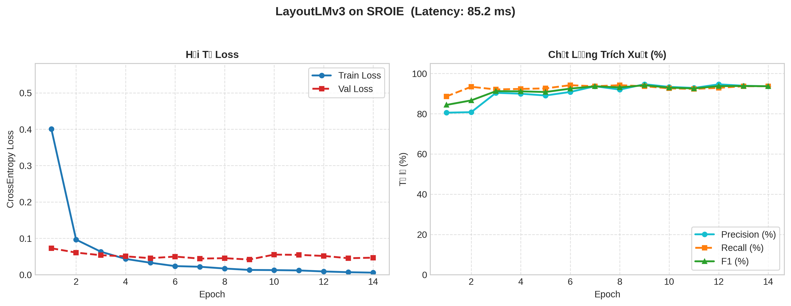

# Báo Cáo Thực Nghiệm: LayoutLMv3 trên Bộ Dữ Liệu SROIE

Giao thức: `ocr-bio-exact-span-v2`. Đây là chỉ số nội bộ, không phải điểm DocILE chính thức.

## 1. Kết Quả Thực Nghiệm Tối Ưu

| Chỉ số | Tập Validation | Tập Test |
|---|:---:|:---:|
| **Precision** | 94.65% | **93.84%** |
| **Recall** | 93.65% | **95.17%** |
| **F1-Score** | 94.15% | **94.50%** |
| **Latency** | 83.43 ms | 160.48 ms |

- **Mô hình**: `LayoutLMv3` | **Thiết bị**: `cuda` | **Tham số**: 125,333,897 | **Epoch tối ưu**: 9
- **Train Loss**: 0.0132 | **Val Loss**: 0.0418

## 2. Kết Quả Theo Từng Nhãn Thực Thể

| Nhãn | Precision | Recall | F1 | Mẫu (Support) |
|---|---|---|---|---|
| `address` | 95.15% | 97.52% | **96.32%** | 161 |
| `company` | 94.20% | 92.86% | **93.53%** | 70 |
| `date` | 96.77% | 98.36% | **97.56%** | 61 |
| `total` | 86.89% | 88.33% | **87.60%** | 60 |
| **Tổng thể** | **93.84%** | **95.17%** | **94.50%** | — |

## 3. Biểu Đồ Huấn Luyện

## 4. Lịch Sử Huấn Luyện

| Epoch | Train Loss | Val Loss | Precision | Recall | F1 | Latency (ms) |
|---|---|---|---|---|---|---|
| 1 | 0.4008 | 0.0728 | 80.53% | 88.62% | **84.38%** | 91.3 |
| 2 | 0.0965 | 0.0610 | 80.78% | 93.39% | **86.63%** | 83.9 |
| 3 | 0.0633 | 0.0537 | 90.39% | 92.06% | **91.22%** | 85.8 |
| 4 | 0.0436 | 0.0506 | 89.95% | 92.33% | **91.12%** | 85.8 |
| 5 | 0.0330 | 0.0456 | 89.06% | 92.59% | **90.79%** | 84.2 |
| 6 | 0.0238 | 0.0500 | 90.82% | 94.18% | **92.47%** | 84.4 |
| 7 | 0.0220 | 0.0444 | 93.65% | 93.65% | **93.65%** | 84.6 |
| 8 | 0.0171 | 0.0455 | 91.99% | 94.18% | **93.07%** | 86.4 |
| 9 | 0.0132 | 0.0418 | 94.65% | 93.65% | **94.15%** | 83.4 |
| 10 | 0.0128 | 0.0554 | 93.33% | 92.59% | **92.96%** | 85.7 |
| 11 | 0.0119 | 0.0547 | 92.82% | 92.33% | **92.57%** | 83.7 |
| 12 | 0.0091 | 0.0517 | 94.61% | 92.86% | **93.72%** | 84.8 |
| 13 | 0.0070 | 0.0455 | 93.90% | 93.65% | **93.77%** | 84.7 |
| 14 | 0.0058 | 0.0469 | 93.65% | 93.65% | **93.65%** | 84.8 |
