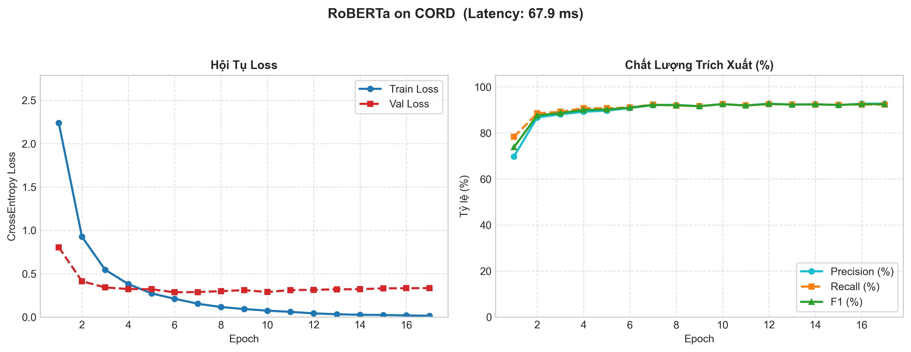

# Báo Cáo Thực Nghiệm: RoBERTa trên Bộ Dữ Liệu CORD

## 1. Kết Quả Thực Nghiệm Tối Ưu

| Chỉ số | Tập Validation | Tập Test |
|---|:---:|:---:|
| **Precision** | 92.70% | **91.03%** |
| **Recall** | 92.48% | **91.51%** |
| **F1-Score** | 92.59% | **91.27%** |
| **Latency** | 67.95 ms | 577.28 ms |

- **Mô hình**: `RoBERTa` | **Thiết bị**: `cuda` | **Tham số**: 129,305,147 | **Epoch tối ưu**: 12
- **Train Loss**: 0.0424 | **Val Loss**: 0.3143

## 2. Kết Quả Theo Từng Nhãn Thực Thể

| Nhãn | Precision | Recall | F1 | Mẫu (Support) |
|---|---|---|---|---|
| `menu.cnt` | 99.52% | 98.10% | **98.80%** | 210 |
| `menu.discountprice` | 40.00% | 50.00% | **44.44%** | 4 |
| `menu.nm` | 96.82% | 95.52% | **96.16%** | 223 |
| `menu.num` | 66.67% | 50.00% | **57.14%** | 4 |
| `menu.price` | 98.18% | 98.18% | **98.18%** | 220 |
| `menu.sub.cnt` | 93.75% | 93.75% | **93.75%** | 32 |
| `menu.sub.nm` | 88.46% | 93.88% | **91.09%** | 49 |
| `menu.sub.price` | 85.71% | 85.71% | **85.71%** | 14 |
| `menu.unitprice` | 88.00% | 88.00% | **88.00%** | 50 |
| `menu.vatyn` | 0.00% | 0.00% | **0.00%** | 1 |
| `sub_total.discount_price` | 62.50% | 71.43% | **66.67%** | 7 |
| `sub_total.etc` | 0.00% | 0.00% | **0.00%** | 2 |
| `sub_total.service_price` | 84.62% | 84.62% | **84.62%** | 13 |
| `sub_total.subtotal_price` | 89.55% | 88.24% | **88.89%** | 68 |
| `sub_total.tax_price` | 89.80% | 91.67% | **90.72%** | 48 |
| `total.cashprice` | 86.96% | 85.71% | **86.33%** | 70 |
| `total.changeprice` | 93.85% | 91.04% | **92.42%** | 67 |
| `total.creditcardprice` | 73.33% | 68.75% | **70.97%** | 16 |
| `total.emoneyprice` | 100.00% | 100.00% | **100.00%** | 4 |
| `total.menuqty_cnt` | 80.65% | 96.15% | **87.72%** | 26 |
| `total.menutype_cnt` | 100.00% | 66.67% | **80.00%** | 3 |
| `total.total_etc` | 0.00% | 0.00% | **0.00%** | 4 |
| `total.total_price` | 89.90% | 88.12% | **89.00%** | 101 |
| **Tổng thể** | **91.03%** | **91.51%** | **91.27%** | — |

## 3. Biểu Đồ Huấn Luyện

## 4. Lịch Sử Huấn Luyện

| Epoch | Train Loss | Val Loss | Precision | Recall | F1 | Latency (ms) |
|---|---|---|---|---|---|---|
| 1 | 2.2389 | 0.8045 | 69.79% | 78.32% | **73.81%** | 67.1 |
| 2 | 0.9273 | 0.4139 | 86.69% | 88.51% | **87.59%** | 67.4 |
| 3 | 0.5458 | 0.3415 | 88.09% | 89.16% | **88.62%** | 67.7 |
| 4 | 0.3806 | 0.3234 | 89.19% | 90.78% | **89.98%** | 67.8 |
| 5 | 0.2733 | 0.3208 | 89.68% | 90.70% | **90.19%** | 68.2 |
| 6 | 0.2109 | 0.2860 | 90.81% | 91.10% | **90.95%** | 67.8 |
| 7 | 0.1539 | 0.2881 | 92.09% | 92.31% | **92.20%** | 68.2 |
| 8 | 0.1154 | 0.2987 | 92.20% | 91.83% | **92.01%** | 68.1 |
| 9 | 0.0929 | 0.3108 | 91.59% | 91.67% | **91.63%** | 67.8 |
| 10 | 0.0740 | 0.2889 | 92.55% | 92.48% | **92.51%** | 67.7 |
| 11 | 0.0599 | 0.3109 | 91.91% | 91.91% | **91.91%** | 68.0 |
| 12 | 0.0424 | 0.3143 | 92.70% | 92.48% | **92.59%** | 67.9 |
| 13 | 0.0326 | 0.3200 | 92.31% | 92.31% | **92.31%** | 67.9 |
| 14 | 0.0265 | 0.3216 | 92.46% | 92.31% | **92.39%** | 67.9 |
| 15 | 0.0239 | 0.3310 | 92.08% | 92.23% | **92.16%** | 67.8 |
| 16 | 0.0194 | 0.3325 | 92.69% | 92.31% | **92.50%** | 68.2 |
| 17 | 0.0148 | 0.3343 | 92.69% | 92.31% | **92.50%** | 67.9 |
