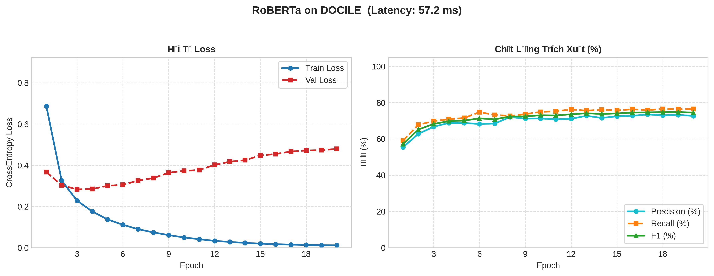

# Báo Cáo Thực Nghiệm: RoBERTa trên Bộ Dữ Liệu DOCILE

Giao thức: `ocr-bio-exact-span-v2`. Đây là chỉ số nội bộ, không phải điểm DocILE chính thức.

## 1. Kết Quả Thực Nghiệm Tối Ưu

| Chỉ số | Tập Validation | Tập Test |
|---|:---:|:---:|
| **Precision** | 73.22% | **77.46%** |
| **Recall** | 76.36% | **82.05%** |
| **F1-Score** | 74.76% | **79.69%** |
| **Latency** | 57.18 ms | 94.56 ms |

- **Mô hình**: `RoBERTa` | **Thiết bị**: `cuda` | **Tham số**: 129,345,135 | **Epoch tối ưu**: 19
- **Train Loss**: 0.0128 | **Val Loss**: 0.4736

## 2. Kết Quả Theo Từng Nhãn Thực Thể

| Nhãn | Precision | Recall | F1 | Mẫu (Support) |
|---|---|---|---|---|
| `account_num` | 91.67% | 64.71% | **75.86%** | 17 |
| `amount_due` | 66.15% | 68.28% | **67.20%** | 372 |
| `amount_paid` | 68.18% | 75.00% | **71.43%** | 40 |
| `amount_total_gross` | 51.88% | 54.57% | **53.19%** | 328 |
| `amount_total_net` | 33.87% | 39.62% | **36.52%** | 53 |
| `amount_total_tax` | 32.35% | 44.00% | **37.29%** | 25 |
| `bank_num` | 72.73% | 53.33% | **61.54%** | 15 |
| `bic` | 100.00% | 57.14% | **72.73%** | 7 |
| `currency_code_amount_due` | 52.27% | 74.19% | **61.33%** | 31 |
| `customer_billing_address` | 78.19% | 82.92% | **80.49%** | 480 |
| `customer_billing_name` | 81.74% | 84.59% | **83.14%** | 545 |
| `customer_delivery_address` | 77.78% | 67.74% | **72.41%** | 31 |
| `customer_delivery_name` | 70.37% | 73.08% | **71.70%** | 26 |
| `customer_id` | 82.02% | 81.56% | **81.79%** | 179 |
| `customer_order_id` | 66.10% | 70.91% | **68.42%** | 55 |
| `customer_other_address` | 58.62% | 70.83% | **64.15%** | 24 |
| `customer_other_name` | 53.52% | 56.72% | **55.07%** | 134 |
| `customer_registration_id` | 0.00% | 0.00% | **0.00%** | 2 |
| `customer_tax_id` | 0.00% | 0.00% | **0.00%** | 1 |
| `date_due` | 95.89% | 90.91% | **93.33%** | 77 |
| `date_issue` | 93.62% | 93.80% | **93.71%** | 548 |
| `document_id` | 88.30% | 91.54% | **89.89%** | 544 |
| `line_item_amount_gross` | 79.69% | 86.17% | **82.80%** | 1,967 |
| `line_item_amount_net` | 65.32% | 38.18% | **48.19%** | 296 |
| `line_item_code` | 63.73% | 61.55% | **62.62%** | 788 |
| `line_item_currency` | 57.02% | 92.00% | **70.41%** | 75 |
| `line_item_date` | 83.45% | 94.47% | **88.62%** | 2,802 |
| `line_item_description` | 67.33% | 73.81% | **70.42%** | 2,585 |
| `line_item_discount_rate` | 0.00% | 0.00% | **0.00%** | 4 |
| `line_item_hts_number` | 100.00% | 100.00% | **100.00%** | 2 |
| `line_item_order_id` | 75.00% | 10.71% | **18.75%** | 28 |
| `line_item_person_name` | 84.21% | 69.57% | **76.19%** | 46 |
| `line_item_position` | 83.68% | 90.75% | **87.07%** | 746 |
| `line_item_quantity` | 87.72% | 94.35% | **90.91%** | 1,787 |
| `line_item_tax` | 55.00% | 55.00% | **55.00%** | 20 |
| `line_item_tax_rate` | 0.00% | 0.00% | **0.00%** | 2 |
| `line_item_unit_price_gross` | 83.75% | 87.54% | **85.60%** | 1,854 |
| `line_item_unit_price_net` | 52.47% | 35.86% | **42.61%** | 237 |
| `line_item_units_of_measure` | 62.50% | 74.07% | **67.80%** | 54 |
| `line_item_weight` | 11.11% | 16.67% | **13.33%** | 6 |
| `order_id` | 72.56% | 80.42% | **76.29%** | 286 |
| `payment_reference` | 60.00% | 60.00% | **60.00%** | 10 |
| `payment_terms` | 77.27% | 85.43% | **81.15%** | 199 |
| `tax_detail_gross` | 21.05% | 28.57% | **24.24%** | 14 |
| `tax_detail_net` | 40.54% | 46.88% | **43.48%** | 32 |
| `tax_detail_rate` | 66.67% | 66.67% | **66.67%** | 6 |
| `tax_detail_tax` | 44.44% | 34.29% | **38.71%** | 35 |
| `vendor_address` | 76.44% | 81.34% | **78.81%** | 670 |
| `vendor_email` | 75.00% | 82.35% | **78.50%** | 51 |
| `vendor_name` | 74.89% | 78.45% | **76.63%** | 673 |
| `vendor_order_id` | 80.95% | 60.71% | **69.39%** | 28 |
| `vendor_registration_id` | 100.00% | 83.33% | **90.91%** | 6 |
| `vendor_tax_id` | 77.94% | 92.98% | **84.80%** | 57 |
| **Tổng thể** | **77.46%** | **82.05%** | **79.69%** | — |

## 3. Biểu Đồ Huấn Luyện

## 4. Lịch Sử Huấn Luyện

| Epoch | Train Loss | Val Loss | Precision | Recall | F1 | Latency (ms) |
|---|---|---|---|---|---|---|
| 1 | 0.6865 | 0.3674 | 55.40% | 59.01% | **57.15%** | 57.4 |
| 2 | 0.3262 | 0.3035 | 62.76% | 67.76% | **65.16%** | 57.1 |
| 3 | 0.2290 | 0.2832 | 66.69% | 69.81% | **68.21%** | 57.4 |
| 4 | 0.1766 | 0.2848 | 68.79% | 70.85% | **69.80%** | 57.5 |
| 5 | 0.1375 | 0.3007 | 68.77% | 71.50% | **70.11%** | 57.2 |
| 6 | 0.1119 | 0.3051 | 68.21% | 74.72% | **71.32%** | 57.3 |
| 7 | 0.0902 | 0.3259 | 68.47% | 73.23% | **70.77%** | 57.3 |
| 8 | 0.0747 | 0.3379 | 72.05% | 72.61% | **72.33%** | 57.1 |
| 9 | 0.0616 | 0.3640 | 71.17% | 73.66% | **72.39%** | 57.2 |
| 10 | 0.0503 | 0.3731 | 71.26% | 74.87% | **73.02%** | 57.2 |
| 11 | 0.0416 | 0.3768 | 70.77% | 75.22% | **72.92%** | 57.1 |
| 12 | 0.0338 | 0.4020 | 71.09% | 76.23% | **73.57%** | 57.3 |
| 13 | 0.0284 | 0.4173 | 72.71% | 75.55% | **74.10%** | 57.2 |
| 14 | 0.0238 | 0.4250 | 71.54% | 76.06% | **73.73%** | 57.3 |
| 15 | 0.0203 | 0.4474 | 72.46% | 75.67% | **74.03%** | 57.2 |
| 16 | 0.0176 | 0.4547 | 72.71% | 76.32% | **74.47%** | 57.1 |
| 17 | 0.0155 | 0.4667 | 73.46% | 75.82% | **74.63%** | 57.2 |
| 18 | 0.0140 | 0.4715 | 73.00% | 76.53% | **74.72%** | 57.1 |
| 19 | 0.0128 | 0.4736 | 73.22% | 76.36% | **74.76%** | 57.2 |
| 20 | 0.0121 | 0.4792 | 72.66% | 76.47% | **74.52%** | 57.1 |
