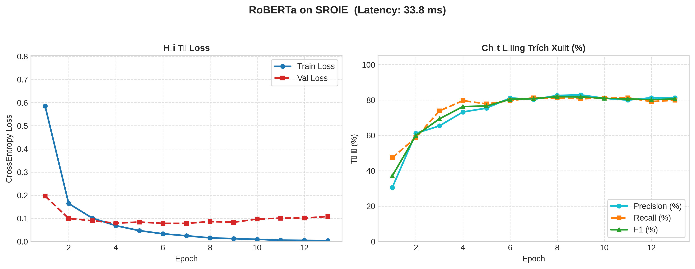

# Báo Cáo Thực Nghiệm: RoBERTa trên Bộ Dữ Liệu SROIE

Giao thức: `ocr-bio-exact-span-v2`. Đây là chỉ số nội bộ, không phải điểm DocILE chính thức.

## 1. Kết Quả Thực Nghiệm Tối Ưu

| Chỉ số | Tập Validation | Tập Test |
|---|:---:|:---:|
| **Precision** | 82.53% | **86.22%** |
| **Recall** | 81.22% | **90.62%** |
| **F1-Score** | 81.87% | **88.37%** |
| **Latency** | 34.42 ms | 41.81 ms |

- **Mô hình**: `RoBERTa` | **Thiết bị**: `cuda` | **Tham số**: 129,266,697 | **Epoch tối ưu**: 8
- **Train Loss**: 0.0157 | **Val Loss**: 0.0862

## 2. Kết Quả Theo Từng Nhãn Thực Thể

| Nhãn | Precision | Recall | F1 | Mẫu (Support) |
|---|---|---|---|---|
| `address` | 87.57% | 91.93% | **89.70%** | 161 |
| `company` | 82.86% | 82.86% | **82.86%** | 70 |
| `date` | 96.83% | 100.00% | **98.39%** | 61 |
| `total` | 76.47% | 86.67% | **81.25%** | 60 |
| **Tổng thể** | **86.22%** | **90.62%** | **88.37%** | — |

## 3. Biểu Đồ Huấn Luyện

## 4. Lịch Sử Huấn Luyện

| Epoch | Train Loss | Val Loss | Precision | Recall | F1 | Latency (ms) |
|---|---|---|---|---|---|---|
| 1 | 0.5852 | 0.1964 | 30.49% | 47.35% | **37.10%** | 29.3 |
| 2 | 0.1641 | 0.0996 | 61.16% | 58.73% | **59.92%** | 32.4 |
| 3 | 0.1013 | 0.0900 | 65.34% | 73.81% | **69.32%** | 34.1 |
| 4 | 0.0687 | 0.0793 | 73.24% | 79.63% | **76.30%** | 34.5 |
| 5 | 0.0470 | 0.0842 | 75.38% | 77.78% | **76.56%** | 34.2 |
| 6 | 0.0334 | 0.0785 | 81.13% | 79.63% | **80.37%** | 34.6 |
| 7 | 0.0248 | 0.0784 | 80.37% | 81.22% | **80.79%** | 34.2 |
| 8 | 0.0157 | 0.0862 | 82.53% | 81.22% | **81.87%** | 34.4 |
| 9 | 0.0124 | 0.0833 | 82.88% | 80.69% | **81.77%** | 34.1 |
| 10 | 0.0094 | 0.0970 | 80.95% | 80.95% | **80.95%** | 34.5 |
| 11 | 0.0056 | 0.1010 | 79.95% | 81.22% | **80.58%** | 34.4 |
| 12 | 0.0050 | 0.1015 | 81.25% | 79.10% | **80.16%** | 34.1 |
| 13 | 0.0044 | 0.1081 | 81.18% | 79.89% | **80.53%** | 34.2 |
